<div align="center">



<a href="https://github.com/itsananya252">
  
</a>

<br/><br/>

<a href="https://github.com/itsananya252?tab=followers"></a>


<br/><br/>

<a href="https://www.linkedin.com/in/ananyadixit1"></a>
<a href="https://leetcode.com/u/AnanyaDixit/"></a>
<a href="https://takeuforward.org/profile/programz_with_dixit"></a>
<a href="mailto:ananyadixit252@gmail.com"></a>

</div>

<br/>


## 👩‍💻 About Me

Hi, I'm **Ananya** 👋, a CS student and aspiring **Full Stack Developer** who loves turning ideas into working products. I enjoy backend engineering with **Java and Spring Boot**, and I'm increasingly curious about **applied AI**: running local LLMs, building RAG pipelines and wiring them into real applications.

```bash
ananya@dev:~$ neofetch --profile

  ┌──────────────────────────────────────────────────────┐
  │  👩‍💻  ROLE        Full Stack Developer | CS Student   │
  │  ☕  CORE STACK  Java · Spring Boot · PostgreSQL · React │
  │  🤖  EXPLORING   Spring AI · Ollama · RAG · System Design │
  │  🧩  PRACTICING  DSA on LeetCode & TakeUForward       │
  │  🟢  STATUS      Fresher, actively building & learning │
  │  💼  OPEN TO     Full Stack roles & internships       │
  └──────────────────────────────────────────────────────┘

ananya@dev:~$ ./start_building.sh
>> Compiling ideas... done ✔
>> Deploying passion... done ✔
```

<br/>

## 🔭 Currently Working On

<table>
<tr>
<td align="center" width="33%">

### 🌱 Sapling
AI-powered hiring platform with RAG-based intelligence *(team project)*


</td>
<td align="center" width="33%">

### 📈 Signal Platform
Final year project generating gold and Nifty prediction signals


</td>
<td align="center" width="33%">

### 🔗 URL Shortener
Shareable short links with versioned DB migrations


</td>
</tr>
</table>

<br/>

## 🚀 Featured Projects

<table>
<tr>
<td width="50%" valign="top">

### 🤖 Spring AI Ollama Chatbot

A chatbot that runs **local LLM-powered conversations** using Spring AI with Ollama, with no external API dependency.


🔗 [**View Code →**](https://github.com/itsananya252/spring-ai-ollama-chatbot)

</td>
<td width="50%" valign="top">

### 📚 Library Management System

A system for managing **books, members and lending workflows**, built with a clean layered Spring Boot architecture.


🔗 [**View Code →**](https://github.com/itsananya252/library-management-system-)

</td>
</tr>
<tr>
<td colspan="2" valign="top">

### 🔗 URL Shortener

Converts long URLs into **short, shareable links**, with a server-side rendered UI and versioned database migrations.


🔗 [**View Code →**](https://github.com/itsananya252/url-shortner)

</td>
</tr>
</table>

<div align="center">

<a href="https://github.com/itsananya252/spring-ai-ollama-chatbot"></a>
<a href="https://github.com/itsananya252/library-management-system-"></a>
<a href="https://github.com/itsananya252/url-shortner"></a>

</div>

<br/>

## 🛠️ Tech Stack

<div align="center">

| Category | Technologies |
|:--------:|:------------:|
| **Languages** |  |
| **Backend** |  |
| **Frontend** |  |
| **Database** |  |
| **Tools** |  |

</div>

<br/>

## 📊 GitHub Stats

<div align="center">


<br/>


</div>

<br/>

## 🏆 Trophies

<div align="center">

</div>

<br/>

## 📈 Contribution Activity

<div align="center">

</div>

<br/>

## 🤝 Let's Connect

I'm open to **Full Stack Developer roles and internships**. If you have an opportunity, a project idea or just want to talk tech, reach out!

<div align="center">

<a href="https://www.linkedin.com/in/ananyadixit1" target="_blank">
  
</a>
<a href="https://leetcode.com/u/AnanyaDixit/" target="_blank">
  
</a>
<a href="https://takeuforward.org/profile/programz_with_dixit" target="_blank">
  
</a>
<a href="mailto:ananyadixit252@gmail.com">
  
</a>

<br/><br/>

⭐ *If you like my work, consider giving my repos a star!* ⭐

</div>


